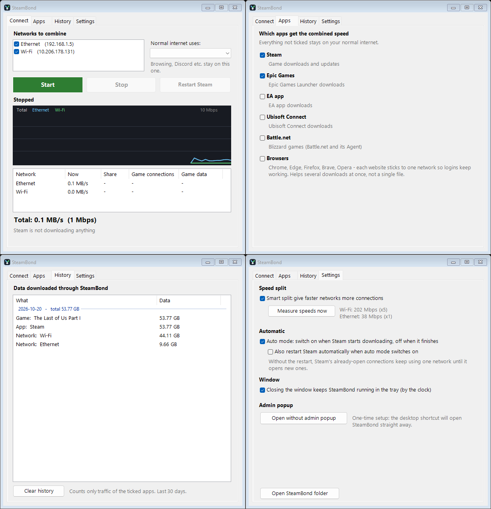

<p align="center"></p>

<h1 align="center">SteamBond</h1>

<p align="center">Download Steam games faster by using two internet connections at once.<br>
Wi-Fi + Ethernet, or home internet + your phone over USB tethering.</p>

<p align="center"></p>

## Install

1. Download **`SteamBond-Setup.exe`** from the [latest release](https://github.com/brutal888/SteamBond/releases/latest).
2. Run it. If Windows shows **"Windows protected your PC"**, click **More info** → **Run anyway** (the app isn't code-signed).
3. Click **Yes** when Windows asks for admin rights. Setup takes about a minute and opens SteamBond.

Or paste this into PowerShell:

```powershell
irm https://raw.githubusercontent.com/brutal888/SteamBond/main/install.ps1 | iex
```

Setup puts SteamBond in `%LOCALAPPDATA%\SteamBond`, adds Desktop and Start Menu shortcuts, and downloads
[mihomo](https://github.com/MetaCubeX/mihomo) from its official GitHub release (checked against a SHA-256 hash).

## Use

1. Connect both internet connections (for example home Wi-Fi + phone on USB tethering).
2. Open **SteamBond**, tick both networks and press **Start**. It tests each network's speed for 6 seconds.
3. Press **Restart Steam** and start your download.

Watch the graph: both networks should be busy. Steam's own download speed should beat either network alone.

## Will it make my downloads faster?

Only if **each network has its own internet**:

| Setup | Faster? |
|---|---|
| Home Wi-Fi + phone (USB tethering or hotspot) | ✅ Yes |
| Two different internet providers | ✅ Yes |
| Wi-Fi and Ethernet from the **same** router | ❌ No, both share one connection* |

\* Exception: if your Ethernet cable or port is capped at 100 Mbps and your plan is faster, Wi-Fi can add the rest.

⚠️ **Watch your mobile data.** Smart split sends more traffic to the faster network, which is often the phone.

## Features

- **Combines networks per connection.** Steam opens dozens of download connections, and SteamBond spreads them across your networks.
- **Smart split.** Faster networks get more connections (up to 5:1), based on a quick speed test.
- **Only games use it.** Steam, Epic Games, EA app, Ubisoft Connect, Battle.net and (optionally) browsers. Everything else stays on your main network.
- **Auto-recover.** Unplug your phone and it carries on. Plug it back in and it's added again.
- **Auto mode.** Switches on when Steam starts downloading and off when it's done.
- **Live graph, per-network stats and history** per day, per network and per game.
- **Tray icon.** Closing the window keeps it running by the clock.
- **No admin popup** after the first install.

## How it works

SteamBond is a small Windows app (PowerShell + WinForms) that drives [mihomo](https://github.com/MetaCubeX/mihomo) in TUN mode.
mihomo captures traffic system-wide, so it works even though Steam ignores proxy settings. The game launchers' connections
go to a round-robin group with one "direct" route per network (repeated to weight faster networks), and everything else
uses your main network. No VPN server, no account, nothing leaves your PC except your normal downloads.

## Uninstall

**Settings → Apps → Installed apps → SteamBond → Uninstall**, or run `uninstall.ps1` in `%LOCALAPPDATA%\SteamBond`.

## Troubleshooting

- **A network doesn't show up.** It needs internet access of its own. On Windows, if Wi-Fi turns off when Ethernet is plugged in, open `gpedit.msc` → *Computer Configuration › Administrative Templates › Network › Windows Connection Manager* → set **Minimize the number of simultaneous connections** to **Disabled**.
- **Antivirus warning.** mihomo is a network tool, and some antivirus products flag it. SteamBond downloads it only from the official MetaCubeX release and checks its hash.
- **Internet stops working.** Open SteamBond and press **Stop**, or exit it from the tray. Your connection goes back to normal immediately.

## Credits

- [mihomo](https://github.com/MetaCubeX/mihomo) by MetaCubeX (MIT), the routing engine.
- Inspired by [Plexo](https://github.com/anmolkapil/plexo) and Speedify.

## License

[MIT](LICENSE)
